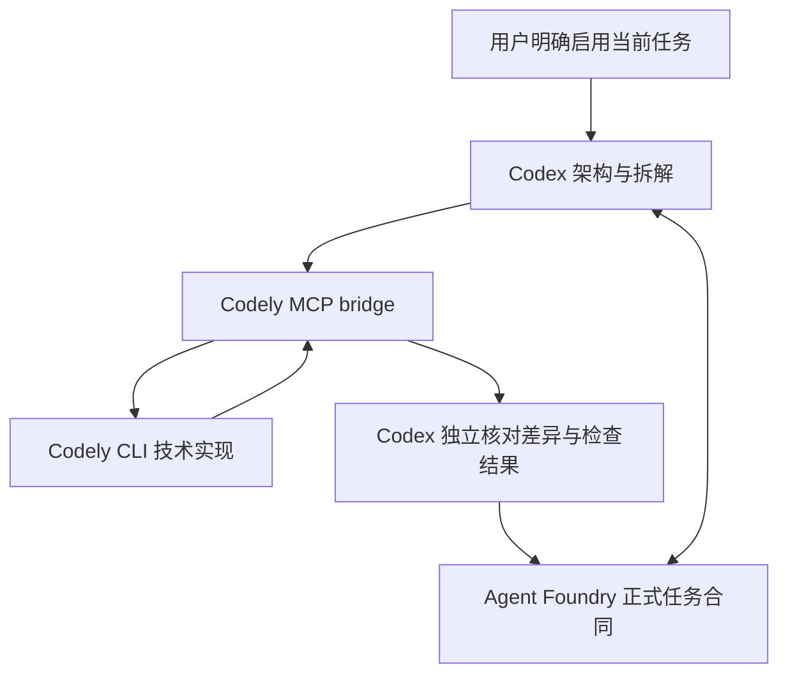

# 协作结构

桥接器只公开 ask_codely/check_job/wait_job/cancel_job/recover_job。任务传入绝对 cwd、技术类别、自包含范围及验收标准；精确 session_id 恢复会话。进程结果、任务交接状态和正式合同关闭是不同层次，成功退出不能自动关闭正式任务。视觉类请求由 Codex 或专用工具处理。

不修改 Agent Foundry 上游技能。通过协作技能及项目规则片段限定 Codely 的启用范围，避免把通用 agent 编排能力误当作 Codely 授权。

桥接执行层使用共享用户状态目录：UUID 标识 job，原子 JSON 快照保存查询依据，独占文件租约协调同项目写入。原桥接退出时不自动释放未知执行的租约，也不重放任务；先确认进程和部分改动，再显式恢复。它不拥有正式任务合同的关闭权，也不是跨机器调度器。

完整策略和任务通过原生 argv 送入 CLI。结构化输出先校验事件形状，文本按 UTF-8 字节截断，有界回答文件与元数据保留在本地。incomplete、CLI 成功和 Codex 验收是不同状态。
